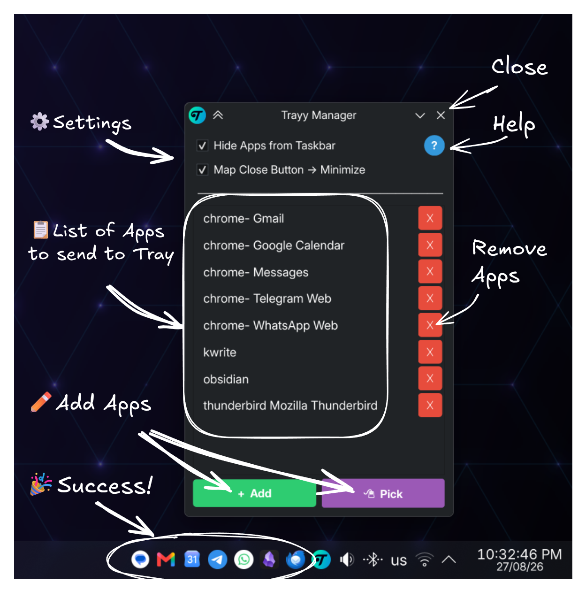

<h1 align="center">
    
    <div>
    Trayy
    </div>
</h1>

<p align="center">
Ever wished you could tell some apps to chill in the system tray? </br>Say hello to Trayy, your desktop's new bouncer!
</br>
</br  >

</p>

<p align="center">
Looking for Trayy for Windows? <a href="https://github.com/alirezagsm/Trayy-Windows">Trayy-Windows</a>
</p>

## 🎯 Features

-   **Send to Tray**: Send your favorite apps to the system tray for a clutter-free workspace!
-   **Hide and Seek Champion**: Enjoy the power to completely hide apps from the taskbar, keeping your desktop neat and tidy.
-   **App Support**: Ideal for Progressive Web Apps (PWAs) and (most) apps that didn't get the memo about system tray support.
-   **Compatible with KDE Plasma**: Built for KDE Plasma on Wayland, with support for system tray icons and window management.
-   **Light as a Feather**: Fully portable and extremely lightweight.

<p align="center">
  
  
</p>

## 🚀 Getting Started

### Method 1: One-liner install

1. Run the install script which installs the Python dependencies, downloads the latest release, installs it to `~/.local/share/trayy`, and creates a desktop entry:

    ```bash
    curl -sL https://raw.githubusercontent.com/alirezagsm/Trayy-KDE/main/install.sh | bash
    ```

2. Launch **Trayy** from your application menu.

3. Activate the KWin script: open **System Settings → Window Management → KWin Scripts**, find **Trayy** in the list, activate it and click **Apply**. Trayy registers a KWin script that it uses for window management.

### Method 2: Manual install

1. Install the Python dependencies:

    ```bash
    pip install dbus-next PyQt6
    ```

2. Kick things off by downloading the latest release from the [Releases page](https://github.com/alirezagsm/Trayy-KDE/releases) and unzipping it to your desired location.
3. Make sure `trayy.pyz` and `trayyd` are hanging out in the same folder. Make them executable and run the app to get the party started:

    ```bash
    chmod +x trayy.pyz trayyd
    ./trayy.pyz
    ```

4. Activate the KWin script: open **System Settings → Window Management → KWin Scripts**, find **Trayy** in the list, activate it and click **Apply**.

### Setup

Time to pick your superpowers:

- **Do not show on Taskbar**: Your app will become the ultimate hide-and-seek champion, staying off the taskbar completely.
- **Send to Tray also when Closed**: Even if you hit the X button, your app will just chill in the tray instead of closing.

Now, list out your favorite apps. Here are the rules:

- Each line is one app entry: `<app_class> [title_filter]`
- The **app class** is matched using a case sensitive substring logic against KWin's window properties (the resource class or name, e.g. `firefox`, `thunderbird`, `org.gimp.GIMP`).
- You can also use the **"Pick"** button to interactively pick your desired app.

> [!IMPORTANT]
> **Heads up:** Trayy relies on KDE KWin's scripting API for window management.

You can modify your entries with these tricks:

- If your app has multiple windows, you can optionally control which window to target by adding the desired title name to your entry. For example `thunderbird Write` will capture the email compose window specifically.
- For even more control, you can use regular expressions by prefixing the app class and/or title filter with `regex:`. For example `kwrite regex:^Daily Notes` will only match the titles starting with 'Daily Notes'.

Done! Depending on your settings, your chosen apps will now be tucked away neatly in the system tray.

## 🖱️ Input Devices & Click Interception

The **Send to Tray also when Closed** feature works by intercepting mouse clicks on window close buttons. This requires Trayy to grab your input device and sit in the middle of the input event chain. Here's how that works:

> [!IMPORTANT]
> **Prerequisite:** Your user must be a member of the `input` group for Trayy to access `/dev/uinput`.
> Add yourself with: `sudo usermod -aG input $USER`, then log out and back in (or run `newgrp input`).

```
Physical Mouse → Kernel → [Other Input Remappers (optional)] → trayyd (grabs + forwards) → libinput → KWin
```

Trayy automatically discovers mouse input devices and will sit **downstream** of any input remapper you might have running. Laptop Trackpad interactions are not captured in this method.

### Using Trayy with Input Remappers

If you use an input remapping tool like **Input Remapper**, **KeyMapper** or similar, you need to take one extra step:

> [!WARNING]
> **Configure your remapper to skip Trayy's forward devices**, or you'll get a feedback loop where clicks are re-processed infinitely.

Trayy creates virtual forward devices named `trayy`. Add a skip rule to your remapper's configuration:

- **KeyMapper**: add `@skip-device /trayy/` to your config
- **Input Remapper**: add `trayy` to the `blacklist` array in your config
- **Other tools**: use an equivalent "ignore/skip device" rule with the `/trayy/` regex pattern

## ✨Tips and Tricks:

-   **Take a peek**: Click on a tray icon to bring its app into the spotlight. If it's already in focus, it'll sneak back into the tray. This way, you can quickly peek at your apps without breaking your workflow!
-   **Startup**: Let Trayy join your startup squad! Add Trayy to your KDE Autostart settings, along with all your other favorite apps you want to keep tucked away in the system tray. Trayy will chill for a bit, letting the startup process finish, then swoop in to tidy everything up! It's a game changer for messaging and productivity apps!

## 😊 Acknowledgements

If Trayy made your workflow smoother, consider supporting its development! ☕✨

[](https://ko-fi.com/Q5Q21EOKMX)
